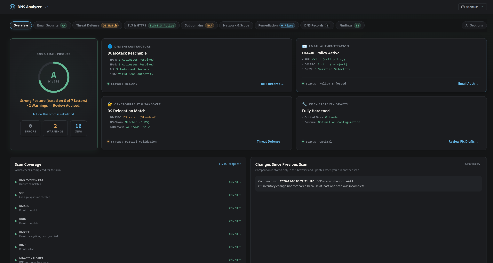

# DNS Analyzer 2.2.0

DNS Analyzer checks a domain’s public DNS, email authentication, DNSSEC delegation, TLS, selected web settings, and known CNAME takeover indicators. It provides a browser dashboard, Python CLI, JSON API, and offline HTML report.

Results are point-in-time observations. They are not a penetration test or a guarantee that a domain is secure. See the [scan guide](docs/scan.md) for check details and limits.



## Run locally

Requirements: Python 3.11 or newer.

```bash
bash run.sh
```

Open <http://127.0.0.1:8000>. The runner prepares `venv/` and starts the server on loopback. Use `bash run.sh 9000` to choose another port, `bash run.sh --setup-only` to prepare without starting, or `bash run.sh --test` to run the test suite.

To run with Docker:

```bash
docker build -t dns-analyzer .
docker run --rm -p 8000:8000 dns-analyzer
```

The local runner binds to `127.0.0.1`. The Docker image listens on `0.0.0.0` inside the container; Docker's published port controls host exposure. For network or public deployment, review [deployment and privacy notes](docs/DEPLOYMENT.md) and put an authenticated, rate-limited proxy in front of the app.

## What it checks

- **DNS:** A, AAAA, MX, NS, TXT, CNAME, SOA, and CAA records; zone-apex discovery; selected DNS configuration checks.
- **Email:** SPF parsing and lookup limits, DMARC, common and custom DKIM selectors, MTA-STS, TLS-RPT, and BIMI.
- **DNS security:** DS-to-DNSKEY comparison, optional DNSSEC chain evidence, AXFR exposure, wildcard DNS, nameserver consistency, and CNAME takeover indicators.
- **Web and inventory:** TLS certificate and negotiation, selected HTTP security headers, Certificate Transparency subdomains, and optional bounded path or port checks.
- **Results:** coverage states, finding explanations, draft remediations, BIND export, browser-local comparison history, and downloadable reports.

The overall grade is a rule-based summary, not a probability of compromise. It shows incomplete checks, excluded factors, and applied score caps. Missing IPv4 or IPv6 alone does not lower the address-resolution score when the other family resolves. See [score and status interpretation](docs/scan.md#scores-findings-and-remediation).

Version 2.2.0 changed score normalization and incomplete-grade reporting. Grades and `--min-grade` results may differ from earlier versions.

## CLI

```bash
bash run.sh --setup-only
./venv/bin/dns-analyzer example.com
./venv/bin/dns-analyzer example.com --json
./venv/bin/dns-analyzer example.com --sarif > findings.sarif
./venv/bin/dns-analyzer example.com --min-grade B --require-complete
```

`--json` and `--sarif` are mutually exclusive. `--min-grade` compares the base grade; `--require-complete` rejects provisional grades. Exit codes are 0 for success, 1 for invalid input or tool failure, 2 for a grade below threshold, 3 for error findings, and 4 for an incomplete grade when completeness is required. Error findings take precedence over grade results.

## API

The main endpoint is `POST /api/analyze` with `{"domain":"example.com"}`. The API also provides custom DKIM checks, subdomain inventory, bounded network diagnostics, offline reports, and a temporary grade badge. See the [API guide](docs/API.md) for routes and examples.

## Deployment notes

- Active port checks are disabled by default and require server-side authorization and target policy.
- DNSSEC chain validation is opt-in. The default DNSSEC result compares DS and DNSKEY data; it does not validate the full chain to the root.
- Takeover fingerprints are heuristic. Shipped entries are unverified, so a match is a candidate rather than confirmation.
- Scan history and short-lived caches are local to the browser or server process. There is no built-in scheduler, account system, or alert delivery.
- DNS, CT, and HTTP checks contact the configured resolver, `crt.sh`, and relevant public targets. More details are in [deployment and privacy notes](docs/DEPLOYMENT.md).

## Related tools

These tools cover adjacent use cases; DNS Analyzer is not a replacement for specialist diagnostics.

| Tool | Best suited to |
|---|---|
| [DNSViz](https://dnsviz.net/) | Visual DNSSEC chain and resolution-path troubleshooting |
| [Zonemaster](https://zonemaster.net/) | Deep DNS delegation and zone-quality testing |
| [MXToolbox](https://mxtoolbox.com/) | Integrated DNS, email, blacklist, and SMTP diagnostics |
| [dnsight](https://pypi.org/project/dnsight/) | Python DNS/email audit CLI and SDK, including SARIF output |

## Project docs

- [Scan guide](docs/scan.md): what each check means and its limitations.
- [API guide](docs/API.md): endpoints and request examples.
- [Deployment and privacy](docs/DEPLOYMENT.md): configuration, outbound requests, logging, and work limits.
- [Finding codes](docs/FINDING_CODES.md): stable codes and legacy aliases.
- [Presentation guide](docs/PRESENTATION.md): demo outline, architecture, and technical Q&A.
- [Changelog](CHANGELOG.md) and [design decisions](DECISIONS.md).

## Development

```bash
./venv/bin/pytest -q
```

The project uses FastAPI, dnspython, Pydantic, Jinja2, and vanilla JavaScript. See `pyproject.toml` and `requirements.txt` for dependencies.
